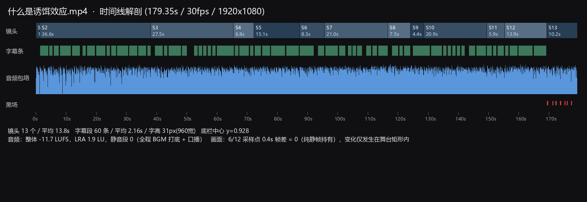
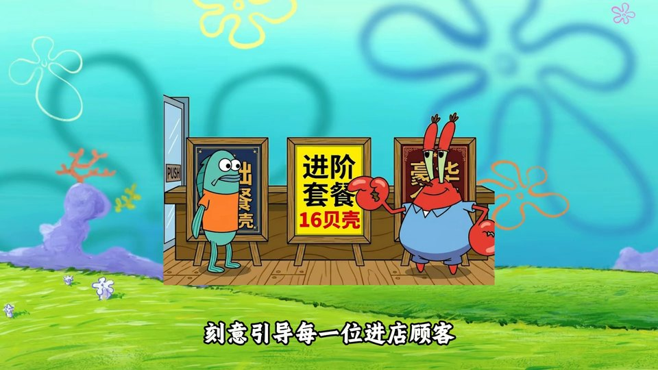
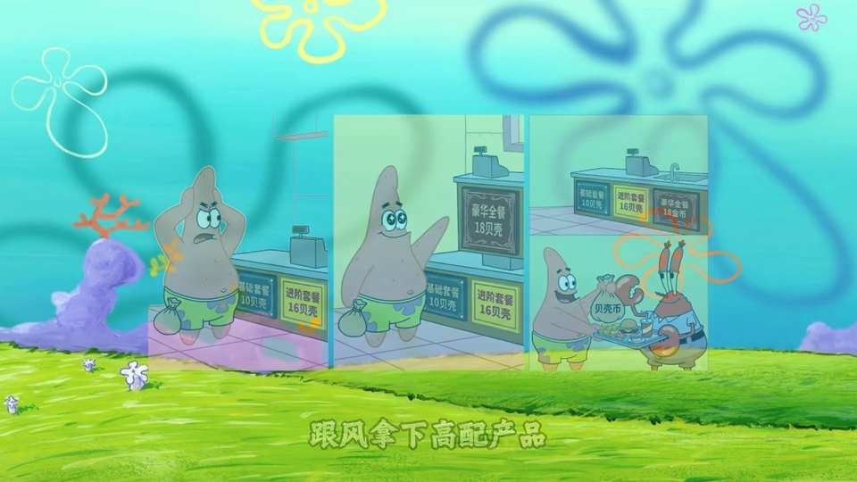
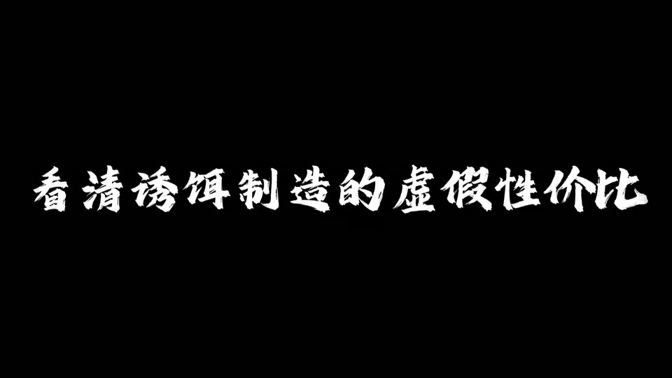
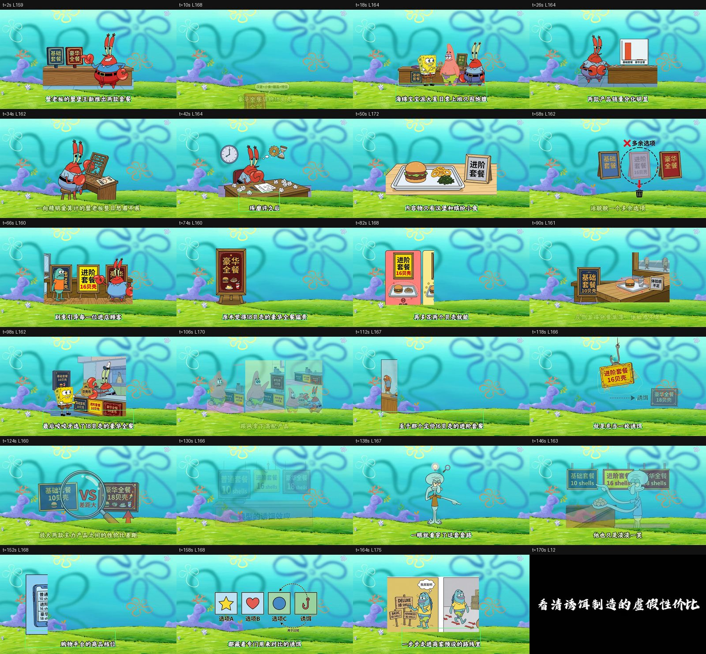

# 参考片解剖：《什么是诱饵效应》（海绵宝宝口播）

> **已被取代（2026-10-18）**：本文关于镜头数、节奏和转场的结论（13 个镜头、平均 13.8 秒、只有硬切和 4 帧叠化）是错的。场景检测阈值太高，漏掉了舞台区域的变化。实测是 67 次画面变化、中位 2.5 秒、0.5–0.7 秒的动作转场。见 [`2026-10-18-reference-anatomy-v2.md`](2026-10-18-reference-anatomy-v2.md)。字幕版式、音频响度等数据仍然有效。


更新：2026-10-17。对象：`D:\Desktop\TO-DO-App\什么是诱饵效应.mp4`。
目的：为"复刻"提供可执行的版式、节奏与素材规格，并与内置扩展 `spongebob-koubo` 的现状逐项对照。



## 0. 结论摘要

1. **它不是动画片，是"静态分镜 + 逐条字幕 + 口播"。** 12 个采样点中 6 个在 0.4 s 内帧差为 0（纯静帧持有），其余变化只发生在画面中段的"舞台矩形"内。逐帧关键帧动画不是复刻的前提。
2. **全片只有一张背景板**（比奇堡海底：青色渐变天空 + 花朵 + 珊瑚 + 紫岩 + 草地），13 个镜头里完全复用。变化的是叠在上面的角色、道具与文字。
3. **节奏的主导变量是字幕，不是镜头。** 13 个镜头（均值 13.8 s）配 60 条字幕（中位 2.16 s），约 1 : 4.6。画面慢、字走得快。
4. **转场只有两种**：硬切（1 帧跳变）与 4–5 帧叠化（0.13–0.17 s）。没有任何花式转场。
5. **瓶颈是美术一致性与版式，不是特效力。** 这套片子在现有编辑器上用"贴图 + 花字 + 音频"就能做；缺的是素材库、版式模板、字幕与节奏控制。

## 1. 片源与时间结构

| 项 | 值 |
| --- | --- |
| 时长 | 179.35 s |
| 画面 | 1920×1080 / 30 fps / H.264 |
| 音频 | AAC 44.1 kHz 立体声；整体 −11.7 LUFS，LRA 1.9 LU，峰值 0 dB，**静音段 0 处** |
| 镜头 | 13 个 |
| 镜头时长 | 1.33 / 36.6 / 27.5 / 6.77 / 15.1 / 8.3 / 21.03 / 7.5 / 4.4 / 20.87 / 5.87 / 13.93 / 10.15 s |
| 字幕 | 60 条，中位 2.16 s，覆盖约 67% 时长，全部单行 |

| 镜头 | 区间 | 内容 |
| --- | --- | --- |
| S1 | 0 – 1.33 | 片头闪切 |
| S2 | 1.33 – 37.93 | 蟹老板介绍两块套餐牌（基础 / 豪华）→ 白板演示 → 背身板书 |
| S3 | 37.93 – 65.43 | 琢磨成本（时钟、齿轮、沙漏、纸团）→ 汉堡套餐 → 红叉"多余选项"+放大镜 |
| S4 | 65.43 – 72.20 | 门店场景：鱼顾客进门 + 三块牌（基础 10 / 进阶 16 / 豪华 18） |
| S5 | 72.20 – 87.30 | 豪华全餐 18 贝壳立牌 → 进阶 + 豪华并列 |
| S6 | 87.30 – 95.60 | 收银台与菜单板 |
| S7 | 95.60 – 116.63 | **三联画**：派大星犹豫 → 买进阶 → 换豪华 |
| S8 | 116.63 – 124.13 | 店员递"进阶套餐 16 贝壳"吊牌，箭头指向"豪华全餐 18 贝壳" |
| S9 | 124.13 – 128.53 | 放大镜 + **VS** 对比（基础 10 vs 豪华 18） |
| S10 | 128.53 – 149.40 | 派大星持教鞭讲解三牌对比 |
| S11 | 149.40 – 155.27 | 手机：购物平台商品详情 |
| S12 | 155.27 – 169.20 | 图标行（选项 A / B / C / 诱饵）+ 漫画分镜（DELUXE 18 / BASIC 10） |
| S13 | 169.20 – 179.35 | 黑场 + 结尾书法字 |




## 2. 转场实测

对切点前后各 0.25 s 抽 15 帧（30 fps）计算逐帧差：

| 切点 | 峰值帧差 | 超过峰值 50% 的帧数 | 判定 |
| --- | --- | --- | --- |
| 37.93 s | 13.6 | 5 | **叠化**，约 0.17 s |
| 95.60 s | 17.3 | 4 | **叠化**，约 0.13 s |
| 149.40 s | 15.6 | 1 | **硬切** |
| （对照 60.00 s，非切点） | 13.2 | 8 | 镜头内元素入场，约 0.27 s 渐变 |

结论：**转场 = 硬切 + 4~5 帧叠化**；镜头内存在约 0.2–0.3 s 的元素入场渐变量。这就是"顺滑但不炫技"的全部来源。

## 3. 视觉系统

- **背景板（唯一）**：青绿海底，天空由 `#61d1d6` 渐变到 `#3ec4d0`，地面草绿，紫色岩礁与珊瑚固定不动。全片零变化。
- **舞台矩形**：内容被放进一个有自己地砖与光照的矩形区域（约占画幅 `x 0.20–0.68, y 0.22–0.72`），边缘硬切。S7 用**三联画**（三个并排舞台）表达"连续动作"，这是把"多次切换"压进一镜的关键手法。
- **元素数**：每镜 2–4 个（角色 1–2 + 道具 1–3 + 标注 0–2）。道具就是信息本身：菜单牌、钟、齿轮、沙漏、天平、纸团、放大镜、红叉、箭头、VS、手机、漫画分镜。
- **三类文字**：
  1. **字幕**（贯穿全片，白字 + 黑粗描边，见 §4）；
  2. **牌面文字**（烤在道具里：`基础套餐 10贝壳` / `进阶套餐 16贝壳` / `豪华全餐 18贝壳`）；
  3. **手绘批注**（`多余选项`、`诱饵`、`VS`）。
- **结尾卡**：纯黑底 + 白色书法体单行（`看清诱饵制造的虚假性比`），持续约 10 s。




## 4. 排印与安全区（可直接用）

| 参数 | 实测值（1920×1080） |
| --- | --- |
| 字幕行数 | 全部单行 |
| 字面高度 | 59–64 px（中位 62 px，占画高 5.7%） |
| 推算字号 | 约 78–82 px（字面率 ≈ 0.78） |
| 水平位置 | 中心 x = 0.500（严格居中） |
| 底线位置 | y = 0.928（底边距 7.2%） |
| 描边 | 黑/白像素比 1.03–1.09 → 描边极粗，约 0.12–0.15 em |
| 覆盖 | 60 条 / 179 s，约 67% |

对照可用的内置样式：`grunge-red-echo`（红做旧）与本片"白字黑粗边"完全不同——这是当前成片"一眼不像"的直接原因之一。

## 5. 节奏与音频

- **镜头 13 个**，均值 13.8 s；最短 1.33 s（片头）、4.4 s（S9 快对比）、最长 36.6 s（S2 开场讲解）。
- **字幕 60 条 / 13 镜 ≈ 4.6 条每镜**：一镜内画面不动、字幕连续推进——这是这类口播片的核心节奏。
- **音频全程无静音**：BGM 打底 + 口播叠加，−11.7 LUFS / LRA 1.9 说明母带经过重度压缩与限幅（短视频平台标准做法）。
- 段落感来自 **BGM 切换 + 画面换场**，不来自静音。



## 6. 与中国内置扩展 `spongebob-koubo` 的差距

对照文件：`extensions/builtin/spongebob-koubo/worker/main.py`（v2.1.0）。

| # | 维度 | 参考片 | 扩展现状 | 严重度 |
| --- | --- | --- | --- | --- |
| 1 | **背景板** | 一张固定海底板，全程复用 | **完全没有背景 item**；画面浮空在工程底色上 | P0 |
| 2 | **占位垃圾** | 无 | 每镜额外生成 2 张 PIL 卡片，写着 `道具 …` / `“…”`（`_write_card`，默认位图字体）——**会直接出现在成片里** | P0（bug） |
| 3 | **片头** | 1.33 s 画面闪切 | 一张红底圆角卡 + PIL 默认字体 `海绵宝宝口播` | P0 |
| 4 | **镜头划分** | 语义驱动，4.4–36.6 s 不等 | `duration / count` **均分**，上限 8 镜 | P1 |
| 5 | **每镜元素** | 2–4 个独立元素，可各自入场 | 1 张 1024² 透明图（`variant` 只换种子）+ 2 张占位卡 | P1 |
| 6 | **文字** | 字幕 / 牌面文字 / 手绘批注三类 | 仅字幕，且 styleId 固定 `grunge-red-echo` | P1 |
| 7 | **字幕排版** | 62 px、居中、底线 0.928、黑粗边 | 无排版参数，全靠 styleId | P1 |
| 8 | **转场** | 硬切 / 4 帧叠化 | "泡泡环扩散"透明视频 + 合成音效，叠在镜头上 | P1 |
| 9 | **BGM** | 三段接续、贴合段落 | 固定 0 / 35% / 75%，gain 0.3，无 ducking | P2 |
| 10 | **结尾卡** | 黑底书法字 10 s | 无 | P1 |
| 11 | **美术一致性** | 同一套角色/道具反复出现 | 每镜独立 `image` 调用，角色形象漂移 | P0（质量根因） |

## 7. 复刻所需的最小能力集

以现有编辑器（`todo_core` + `todo_media` + 花字 + 音频）为准：

| 能力 | 现状 | 判定 |
| --- | --- | --- |
| 贴图 + 位置/缩放/不透明度 | 已有 | **够用** |
| 花字（多层填充/描边） | 已有（`todo_text`） | **够用**，需内置"白字黑粗边"样式 |
| 逐条字幕（text clip） | 已有 | **够用** |
| 元素入场 pop/rise（0.2–0.3 s） | 已有（`intro` 8 条曲线） | **够用** |
| 牌面文字叠在道具上 | 已有（text clip 定位） | **够用** |
| 手绘标注（红叉/箭头/放大镜/VS） | 已有（图片素材 + intro） | **够用** |
| 硬切 | 已有 | **够用** |
| 4 帧叠化 | 无 transition 原语；可用两层重叠 + `intro`/`outro` 淡入淡出近似 | **勉强够用** |
| 三联画版式 | 三个贴图并排 | **够用** |
| 黑底结尾卡 + 书法字 | 已有 | **够用** |
| 角色/道具素材库 | **无**（每镜调 image 生成） | **缺** |
| 版式模板（舞台矩形位置） | 无 | **缺** |
| 镜头按语义切分 | 无（均分） | **缺** |

**结论：引擎不缺，缺的是"素材库 + 版式模板 + 语义切分"。** 这与"补关键帧/特效引擎"的方向相反——后者对本片几乎无用。

## 8. 行动计划

### P0（约 1 周，不动引擎）
1. 删除 `_shot_support_items` 的两张占位卡与红片头卡（直接提升成品可看性）。
2. 新增**背景板** item：`assets/plate/bikini-bottom.png` 铺满画布，全片一条。
3. 建**素材库**：6–10 个透明 PNG（蟹老板、派大星、鱼顾客、菜单牌、钟、天平、红叉、箭头、放大镜）。`chat` 只负责"选素材 + 排位置 + 写牌面文字"，不再逐镜生图 → 一致性立刻成立。
4. 字幕换成"白字 + 黑粗描边"样式，参数按 §4（62 px / 居中 / 底线 0.928 / 单行）。
5. 结尾卡：黑底 + 书法字。

### P1（1–2 周）
6. 镜头按口播语义切分（用 `speech` 时间轴 + `subtitles` 断句，替代均分）。
7. 牌面文字拆成独立 text clip（可改字、可换色）。
8. 转场改 4 帧叠化（两层重叠 + 淡入淡出）；泡泡转场保留为题材变体。
9. 三联画版式（三舞台并排）。

### P2
10. BGM 按段落边界对齐 + 口播 ducking。
11. 元素入场与字幕换字对齐（本片节奏：每 2.16 s 一次语义推进）。

## 9. 验收指标（可自动比对）

| 维度 | 目标 |
| --- | --- |
| 镜头数 | 13 ± 2 |
| 字幕条数 / 中位时长 | 60 ± 10 条 / 2.2 ± 0.4 s |
| 字幕字面高度 | 62 ± 6 px @1080p |
| 字幕中心 / 底线 | x 0.50 ± 0.03 / y 0.928 ± 0.01 |
| 每镜元素数 | 2–4 |
| 背景一致性 | 各镜首帧背景 SSIM > 0.9 |
| 音频 | −12 ± 2 LUFS，LRA < 4，静音段 0 |
| 观感 | 按镜对位抽帧 SSIM > 0.55 视为"同一版式" |

## 10. 分析产物与复现

本次解剖脚本与数据在 `target/analysis/baite/`（`target/` 不入库）：

```text
analyze.py      抽帧统计、调色板、字幕带检测、contact sheet
timeline.py     字幕连续段、音频 RMS 包络、解剖图
frames/         24 张定点抽帧（1920×1080）
subs/           2 fps 全片帧（960 宽，用于字幕检测）
timeline.json   切点 / 字幕段 / 包络
stats.json      逐帧调色板与字幕度量
contact_sheet.png / anatomy.png
```

如需对其它参考片复用，可把这两支脚本提升为 `scripts/analyze_reference.py`（参数化输入/输出，切点自动检测）。
